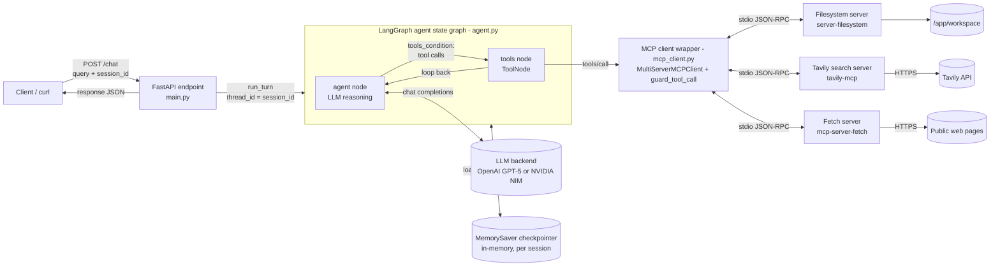
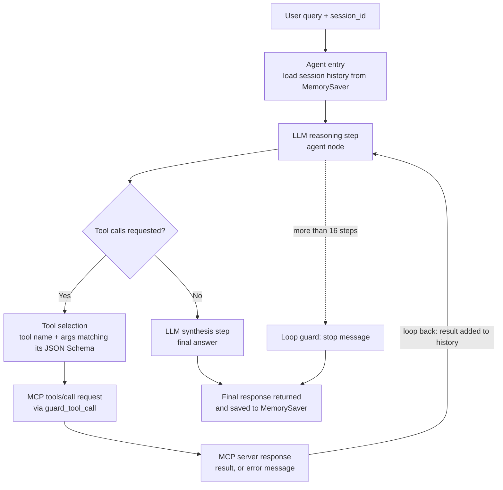
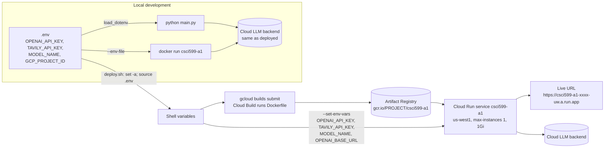

# CSCI 599 Assignment 1 — Tool-Using Agent with MCP Integration

A LangGraph agent served over FastAPI. It reasons about each query, discovers and calls tools from **three MCP servers** (filesystem, Tavily search, fetch), remembers the conversation per session, and runs on **Google Cloud Run**.

- **Live URL:** `<PASTE_YOUR_CLOUD_RUN_URL_HERE>`
- **Author:** `<YOUR NAME>` — Fall 2026
- **Framework:** LangGraph + FastAPI + `langchain-mcp-adapters`
- **LLM backend:** `<OpenAI GPT-5 | NVIDIA NIM model id>` (set by `MODEL_NAME`)

---

## Contents
1. [Features](#1-features)
2. [Project Structure](#2-project-structure)
3. [How It Works](#3-how-it-works)
4. [MCP Servers](#4-mcp-servers)
5. [Prerequisites](#5-prerequisites)
6. [Setup](#6-setup)
7. [Run Locally](#7-run-locally)
8. [Deploy to Cloud Run](#8-deploy-to-cloud-run)
9. [API](#9-api)
10. [Testing & Verification](#10-testing--verification)
11. [Error Handling](#11-error-handling)
12. [Architecture Diagrams](#12-architecture-diagrams)
13. [Cost Disclosure](#13-cost-disclosure)
14. [Troubleshooting](#14-troubleshooting)
15. [Attribution](#15-attribution)

---

## 1. Features

| Requirement | How it's met |
|---|---|
| ≥2 MCP servers | Filesystem + Tavily Search (required) + Fetch (additional) |
| Real MCP protocol | `MultiServerMCPClient` runs `tools/list` on each server at startup and `tools/call` over stdio JSON-RPC for every tool use. Nothing is simulated. |
| Tool reasoning | Explicit LangGraph state graph: the LLM decides whether to call a tool, sees the result, and loops until it can answer. It answers directly when no tool is needed. |
| Multi-step chaining | The loop allows several tool calls per turn, e.g. search → fetch → write file |
| Memory | LangGraph `MemorySaver` checkpointer with `thread_id = session_id` |
| Failure handling | Transport failures, tool execution errors, malformed responses, timeouts, and runaway loops all return a clean JSON reply |
| Deployment | Multi-stage Docker build, non-root user, Cloud Run `us-west1`, `PORT` read from env |

---

## 2. Project Structure

```
.
├── main.py                  # FastAPI app: POST /chat, GET /health; binds 0.0.0.0:$PORT
├── agent.py                 # LangGraph state graph, LLM setup, MemorySaver, run_turn()
├── mcp_client.py            # Loads mcp_config.json, tools/list per server, tools/call guard
├── mcp_config.json          # MCP server manifest (no secrets; ${VARS} filled from env)
├── requirements.txt         # Runtime dependencies (pinned)
├── requirements-dev.txt     # + pytest, httpx
├── Dockerfile               # Multi-stage build, Node MCP servers preinstalled, non-root user
├── deploy.sh                # Cloud Build + Cloud Run deploy, reads .env
├── .env.example             # Placeholder settings — copy to .env
├── .gitignore / .dockerignore / .gcloudignore
├── docs/                    # PNG renders of the three architecture diagrams
├── tests/
│   ├── conftest.py              # Fixtures + ScriptedChatModel (fake LLM for offline tests)
│   ├── test_mcp_integration.py  # Real tools/list + tools/call, all failure modes
│   ├── test_agent.py            # Tool chaining, no-tool answers, memory, loop guard
│   ├── test_api.py              # HTTP contract and error responses
│   ├── test_live.py             # Real LLM end-to-end (runs only with OPENAI_API_KEY)
│   └── fake_servers/broken_server.py  # Deliberately broken MCP server for failure tests
├── README.md
└── PROCESS_LOG.md
```

---

## 3. How It Works

1. **Startup** (`main.py` lifespan → `agent.build_agent`):
   `mcp_client.discover_tools` reads `mcp_config.json`, fills in `${VAR}` placeholders from the environment, and runs `tools/list` on each server separately. Each MCP tool becomes a LangChain tool whose argument schema is the server's JSON Schema. A server that fails is skipped and reported on `/health`; the others still load.
2. **Graph** (`agent.build_graph`): two nodes.
   - `agent` calls the LLM with a system prompt plus the session's message history.
   - `tools` (LangGraph `ToolNode`) executes the requested tool calls.
   - `tools_condition` routes `agent → tools` when the LLM asked for tools and `agent → END` otherwise. `tools → agent` is the loop-back edge.
3. **Tool calls**: every `tools/call` passes through `guard_tool_call` (an adapter interceptor). It logs the call, enforces a timeout, and turns transport failures and malformed responses into error results the LLM can read.
4. **Memory**: the graph is compiled with `MemorySaver`. `run_turn` passes `thread_id = session_id`, so each session keeps its own message history while the instance is running.
5. **Request**: `POST /chat` validates the body, runs one turn, and returns the last AI message as `{"response": ...}`.

Each tool call opens a fresh stdio session to its server (the adapter's default). This costs roughly 0.3–1 s per call. In exchange, a server that crashes recovers on the next call instead of staying broken for the life of the instance.

---

## 4. MCP Servers

| Server | Package | Transport | Used for | Key |
|---|---|---|---|---|
| **Filesystem server** | `@modelcontextprotocol/server-filesystem` 1.0.0 (Node) | stdio | Read, write, list, and search files under `WORKSPACE_DIR` (14 tools) | None |
| **Tavily search server** | `tavily-mcp` 0.2.22 (Node) | stdio | Web search and extraction for current or factual questions (`tavily_search`, `tavily_extract`, …) | `TAVILY_API_KEY` |
| **Fetch server** *(additional)* | `mcp-server-fetch` (Python) | stdio | Full content of a specific URL as markdown (`fetch`) | None |

### Why the Fetch server (additional server rationale)
Tavily returns search results and snippets. Some requests need one **specific page in full**, for example "summarize this article" or "read these docs and save the key points." Fetch fills that gap, is free, needs no key, and installs with pip inside the same container. It also enables a natural three-server chain: **Tavily search → fetch a result → write notes with the filesystem server**.

### `mcp_config.json`
```json
{
  "filesystem": { "transport": "stdio", "command": "mcp-server-filesystem", "args": ["${WORKSPACE_DIR}"] },
  "tavily":     { "transport": "stdio", "command": "tavily-mcp", "args": [],
                  "env": { "TAVILY_API_KEY": "${TAVILY_API_KEY}" } },
  "fetch":      { "transport": "stdio", "command": "${PYTHON}", "args": ["-m", "mcp_server_fetch"] }
}
```
- `${TAVILY_API_KEY}` comes from the environment at startup, so the key is never in the file.
- `${WORKSPACE_DIR}` resolves to an absolute path, which is the only directory the filesystem server may touch.
- `${PYTHON}` is the running interpreter, so the fetch server uses the same environment (your venv locally, `/usr/local` in Docker).
- Stdio servers receive only a minimal environment, which is why the Tavily key is passed explicitly under `env`.

---

## 5. Prerequisites

| Tool | Version | Purpose |
|---|---|---|
| Python | 3.13 | App runtime |
| Node.js + npm | 20+ | Runs the filesystem and Tavily MCP servers |
| Docker | Recent | Local container test |
| gcloud CLI | Latest | Cloud Run deploy |
| API keys | — | `OPENAI_API_KEY` (or NVIDIA NIM key) and `TAVILY_API_KEY` |

Keys:
- OpenAI — https://platform.openai.com/api-keys
- NVIDIA NIM (free) — https://build.nvidia.com
- Tavily (student Project Plan available) — https://tavily.com

---

## 6. Setup

```bash
# 1. Python environment
python3.13 -m venv .venv
source .venv/bin/activate              # Windows: .venv\Scripts\activate
pip install -r requirements-dev.txt

# 2. Node MCP servers (same versions as the Docker image)
npm install -g @modelcontextprotocol/server-filesystem@1.0.0 tavily-mcp@0.2.22

# 3. Settings
cp .env.example .env                   # then put your real keys in .env — never commit it
```

**Using NVIDIA NIM instead of OpenAI:** put your NIM key in `OPENAI_API_KEY`, set `OPENAI_BASE_URL=https://integrate.api.nvidia.com/v1`, and set `MODEL_NAME` to the model id shown on build.nvidia.com. No code changes are needed.

---

## 7. Run Locally

### Python
```bash
python main.py                         # serves on http://localhost:8080 (or $PORT)
```

### Docker (closest to Cloud Run)
```bash
docker build -t csci599-a1 .
docker run --rm -p 8080:8080 --env-file .env csci599-a1
```

### Smoke test
```bash
curl -s http://localhost:8080/health

curl -s -X POST http://localhost:8080/chat \
  -H "Content-Type: application/json" \
  -d '{"query": "Create notes.txt that says hello, then read it back.", "session_id": "demo"}'
```

---

## 8. Deploy to Cloud Run

### One-time GCP setup
```bash
gcloud auth login
gcloud config set project YOUR_PROJECT_ID
gcloud services enable run.googleapis.com cloudbuild.googleapis.com artifactregistry.googleapis.com
```

### Deploy
```bash
./deploy.sh
```
`deploy.sh` sources `.env`, checks that the required keys are set, builds the image with Cloud Build (`gcr.io/$GCP_PROJECT_ID/csci599-a1`), and deploys it. It prints the live URL (`https://csci599-a1-xxxxxxxxxx-uw.a.run.app`). Paste that URL at the top of this README and into Brightspace.

Differences from the assignment's sample command, and why:
- **`TAVILY_API_KEY` is passed** in `--set-env-vars`. The sample passes only the OpenAI key, so search would run without a key in the cloud.
- **`OPENAI_BASE_URL` is passed** only if it is set (NIM users).
- **`--memory 1Gi`** instead of 512Mi. Python, the LLM client, and MCP subprocesses (two of them Node) can exceed 512Mi.
- `WORKSPACE_DIR` and `MCP_SERVERS_CONFIG` are set by the Dockerfile's `ENV`, so they don't need to be passed.
- **`--max-instances 1`** keeps every session on one instance, so `MemorySaver` works. Memory resets when the instance scales to zero, which the assignment allows.

### Verify
```bash
URL=https://csci599-a1-xxxxxxxxxx-uw.a.run.app
curl -s "$URL/health"
curl -s -X POST "$URL/chat" -H "Content-Type: application/json" \
  -d '{"query": "Search the web for the latest LangGraph release and summarize it.", "session_id": "deploy-check"}'
gcloud run services logs read csci599-a1 --region us-west1 --limit 50
```

---

## 9. API

### `POST /chat`
```json
// request
{ "query": "string", "session_id": "string" }
// response
{ "response": "string" }
```

| Status | When |
|---|---|
| 200 | Normal answer. This includes answers that explain a failed tool. |
| 422 | Missing or empty `query` / `session_id` |
| 502 | LLM backend rejected the request (e.g. bad key) |
| 503 | LLM backend rate-limited or unreachable |
| 500 | Any other unexpected error, logged with a traceback |

Every non-422 status uses the same `{"response": ...}` body.

### `GET /health`
Returns each MCP server's status and the tool names it discovered through `tools/list`:
```json
{"status": "ok", "mcp_servers": [{"name": "filesystem", "ok": true, "tools": ["read_file", "..."], "error": null}, ...]}
```

### Example queries

| Behavior | Query |
|---|---|
| No tool needed | `What is the difference between a stack and a queue?` |
| Filesystem | `Create a file called notes.txt that says hello world, then read it back.` |
| Search | `What are the latest developments in the Model Context Protocol?` |
| Fetch | `Fetch https://modelcontextprotocol.io and summarize the main page.` |
| Multi-step chain | `Search for the official LangGraph docs, fetch the overview page, and save a 5-bullet summary to langgraph.md.` |
| Memory, turn 1 | `My name is Edmarck and I'm studying agentic AI.` |
| Memory, turn 2 (same `session_id`) | `What's my name, and what did I ask you last?` |
| Session isolation (new `session_id`) | `What's my name?` → should not know |

---

## 10. Testing & Verification

```bash
pytest -v                    # 21 offline tests; no API keys needed
pytest tests/test_live.py -v # 3 end-to-end tests with the real LLM (needs OPENAI_API_KEY in .env)
```

The offline tests use the **real** filesystem and fetch MCP servers and a scripted stand-in for the LLM (`ScriptedChatModel`). Graph logic, MCP traffic, and memory are therefore tested without spending API credits.

| File | What it proves |
|---|---|
| `test_mcp_integration.py` | `tools/list` discovers real tools and their JSON Schemas. `tools/call` writes and reads a real file. A tool execution error (reading `/etc/passwd`) comes back as an error message. A missing server binary, a server that prints garbage, and a bad config file are skipped without crashing. A malformed result, an unsupported content type, and a server crashing mid-call each become error messages. |
| `test_agent.py` | The graph chains two real tool calls (write → read) and the LLM's second step sees the first result. A general question produces zero tool calls. Memory is shared within a session and isolated between sessions. The loop guard stops runaway tool calls and the session still works afterwards (both repair paths). |
| `test_api.py` | Response contract, 422 on bad input, clean 500/503 JSON on errors, `/health` format. |
| `test_live.py` | With the real LLM: no tool for a knowledge question, filesystem tools for a file request, memory across two turns. |

### Watching real MCP traffic
Every call is logged by `guard_tool_call`:
```
INFO mcp_client: tools/list 'filesystem': 14 tools ['read_file', 'read_text_file', ...]
INFO mcp_client: tools/call -> filesystem.write_file args={'path': '/app/workspace/notes.txt', 'content': 'hello'}
INFO mcp_client: tools/call <- filesystem.write_file isError=False blocks=1
```
Locally these appear in your terminal. On Cloud Run use `gcloud run services logs read`. You can also inspect a server by hand:
```bash
npx @modelcontextprotocol/inspector mcp-server-filesystem ./workspace
```

### Manual failure probes
| Probe | How | Expected |
|---|---|---|
| Server unavailable | Change a server's `command` in `mcp_config.json` to a bad path and restart | `/health` shows `ok: false`. The agent still answers with the other servers. |
| Tool execution error | Ask: `Read the file /etc/passwd` | The agent explains that access was denied |
| Bad Tavily key | Set `TAVILY_API_KEY=invalid` | Search reports an error. Other queries still work. |
| Bad LLM key | Set `OPENAI_API_KEY=invalid` | `/chat` returns 502 with a JSON message, no crash |

---

## 11. Error Handling

| Layer (file) | What's caught | Result |
|---|---|---|
| Startup (`mcp_client.discover_tools`) | Server won't launch, times out (30 s), or answers `tools/list` with garbage; unreadable config | Server skipped and logged; shown on `/health`; remaining servers load |
| Tool execution (`langchain-mcp-adapters`) | MCP result with `isError: true` | Returned to the LLM as an error `ToolMessage`, which the LLM explains |
| Transport (`guard_tool_call`) | Server process dies, stream closes, timeout (60 s) | Converted to an error result naming the server |
| Malformed response (`guard_tool_call`) | Invalid JSON-RPC result or schema mismatch (raised by the MCP SDK's validation), unsupported content blocks | Converted to an error result |
| Last resort (`ToolNode(handle_tool_errors=...)`) | Any other exception inside a tool | Becomes an error `ToolMessage` |
| Loop guard (`agent.run_turn`) | More than `AGENT_RECURSION_LIMIT` (16) graph steps, about 7 tool calls | Returns a "stopped" message and repairs saved history so the session stays usable |
| HTTP (`main.chat`) | LLM rate limit / outage / rejection; anything unexpected | 503 / 502 / 500 with a JSON `response`, traceback in logs |

---

## 12. Architecture Diagrams

The Mermaid sources below render on GitHub. Rendered PNG copies are in [`docs/`](docs/) for viewers that don't support Mermaid.

### Diagram 1 — System Architecture


### Diagram 2 — Tool Invocation Flow (with loop-back)

*After every tool result the LLM reasons again and either calls another tool or writes the final answer. That loop is what allows chained calls.*

### Diagram 3 — Deployment Topology


---

## 13. Cost Disclosure

| Service | Tier | Cost for this assignment |
|---|---|---|
| Cloud Run | $50 education credit | ~$0 idle (scale-to-zero); actual: `<fill in>` |
| Cloud Build / Artifact Registry | Education credit | Cents per build; actual: `<fill in>` |
| OpenAI GPT-5 *(or NVIDIA NIM free tier)* | Pay-as-you-go *(or free, ~40 req/min)* | Actual: `<fill in from usage dashboard>` |
| Tavily | Free / student Project Plan (4,000 credits/mo) | $0 |
| Filesystem + Fetch MCP servers | Open source | $0 |

---

## 14. Troubleshooting

| Symptom | Fix |
|---|---|
| `OPENAI_API_KEY is not set` at startup | Fill in `.env` locally, or check `--set-env-vars` on Cloud Run |
| `/health` shows a server with `ok: false` | Locally: are the Node servers installed globally (`npm ls -g`)? Check the startup logs for the error. |
| Memory "forgets" between requests | Send the same `session_id`. Confirm `--max-instances 1`. A reset after scale-to-zero is expected. |
| Tavily works locally but not on Cloud Run | `TAVILY_API_KEY` missing from `--set-env-vars` (`deploy.sh` checks for it) |
| Container OOM restarts | Increase `--memory` in `deploy.sh` |
| Fetch refuses a site | `mcp-server-fetch` respects `robots.txt` by default. The agent reports the refusal. |
| Slow first request | Cold start plus a new server process per tool call. `--min-instances 1` removes the cold start but costs money. |

---

## 15. Attribution

**MCP servers (external open-source projects, used as-is):**
- Filesystem MCP server — https://github.com/modelcontextprotocol/servers/tree/main/src/filesystem
- Fetch MCP server — https://github.com/modelcontextprotocol/servers/tree/main/src/fetch
- Tavily MCP server — https://github.com/tavily-ai/tavily-mcp

**Frameworks and libraries:** LangGraph, LangChain Core, `langchain-openai`, `langchain-mcp-adapters`, MCP Python SDK, FastAPI, Uvicorn, python-dotenv, pytest.

**Adapted code:** `<list any code adapted from tutorials or docs with its URL. It must also appear as "# Adapted from <URL> — <reason>" in the source and in PROCESS_LOG.md.>`

**AI-assisted development:** see `PROCESS_LOG.md`.
